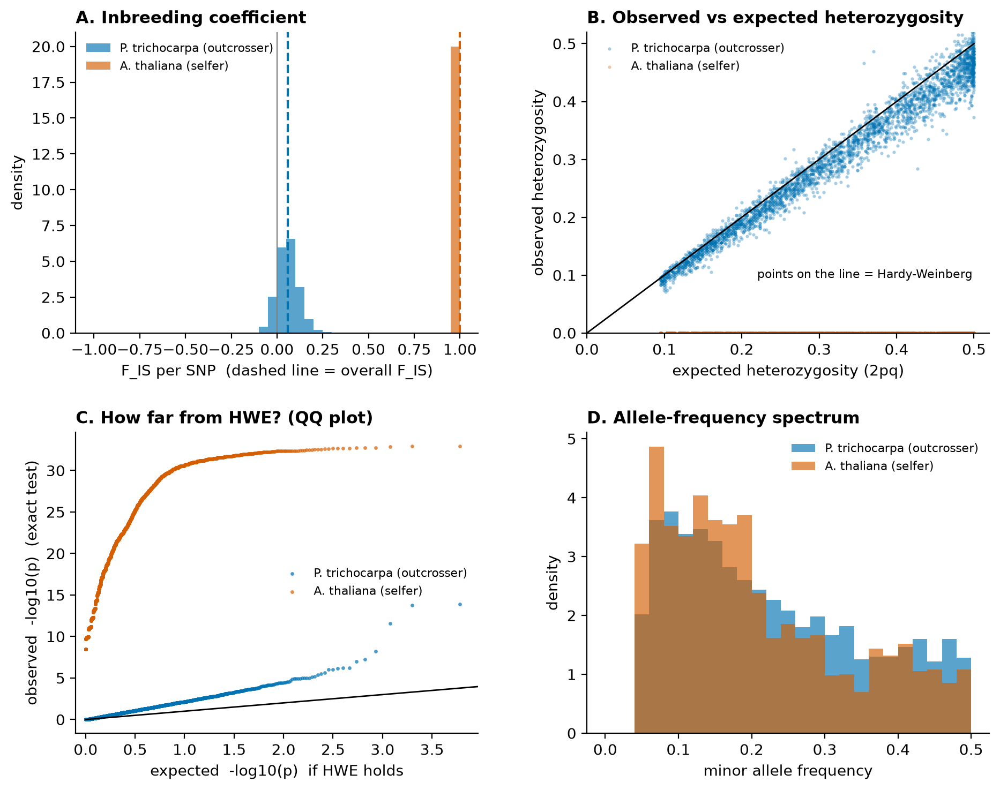

# Selfer vs. outcrosser: how mating system shapes genotype frequencies

**Author:** Vanshika Yadav · B.Sc. (Hons) Botany, Gargi College, University of Delhi

Built as a Genetics (DSC) project: Hardy-Weinberg equilibrium and F_IS in a selfer vs. an outcrosser.



[Read the full report](docs/REPORT.md)

**Question.** How does mating system change genotype frequencies, and how does that show up in the Hardy-Weinberg chi-square test and in the inbreeding coefficient F_IS?

| | Selfer | Outcrosser |
|---|---|---|
| Species | *Arabidopsis thaliana* | *Populus trichocarpa* (black cottonwood) |
| Data | 1001 Genomes sequencing SNPs (VCF subset tool, Spanish accessions) | 4,654 SNP-array genotypes, Zenodo 10.5281/zenodo.7129889 |
| Individuals analysed | 110 accessions | 448 individuals |
| SNPs tested | 3,000 (first 2 Mb of chromosome 1) | 3,000 |
| Mean H_obs / H_exp | 0.000 / 0.295 | 0.299 / 0.318 |
| Overall F_IS | 1.000 | 0.060 |
| SNPs failing HWE, exact test p < 0.05 (raw) | 100% | 25.0% |
| After FDR 5% / Bonferroni | 100% / 100% | 7.7% / 0.8% |

## What the results show
The outcrosser has a small heterozygote deficit (F_IS = 0.060). The selfer has no heterozygous calls at all (F_IS = 1.000). The direction matches the prediction: selfing removes heterozygotes, and random mating gives genotype frequencies close to p², 2pq, q².

**Read these carefully:**
- The *A. thaliana* value of 1.000 is the maximum possible F_IS, not an estimate of the selfing rate. The 1001 Genomes call set contains no heterozygous genotypes (inbred lines are called as homozygous), so the result is partly a property of the data format.
- The *A. thaliana* SNPs come from the first 2 Mb of chromosome 1 only. The requested 3 Mb download was cut off by a server error at about 2.17 Mb, so the complete first 2 Mb were used.
- The *P. trichocarpa* deficit may reflect population structure or relatedness (Wahlund effect). This has not been tested here.
- Similar allele-frequency spectra (panel D) do not imply similar genotype frequencies. Selfing mainly changes how alleles are paired into genotypes.
- Chi-square is valid (all expected counts ≥ 5) for only 35.6% of selfer SNPs and 79.5% of outcrosser SNPs, so the exact test is the primary test.

## Status
| Part | Status |
|---|---|
| Code (`scripts/`) | written and unit-tested |
| Tests (`tests/`) | pass: exact test matches a brute-force calculation, chi-square matches SciPy, hand-worked textbook example, simulation recovers the true F |
| Synthetic demo (`example_synthetic/`) | done. Headed "SYNTHETIC TEST DATA – PIPELINE VALIDATION ONLY": simulated data with known F, **not a result for any real species** |
| Real data | run. Results are in `results/`, the figure is in `figures/`, and the write-up is in `docs/REPORT.md` |

## How to run
```
pip3 install -r requirements.txt
bash scripts/01_fetch_data.sh              # downloads the Populus data from Zenodo
# fetch an A. thaliana subset from https://tools.1001genomes.org/vcfsubset
bash scripts/run_all.sh data/athaliana_subset.vcf data/Panel4SNPv3.vcf 3000
```
The raw VCF files are not stored in this repository because of their size (see `data/README.md`).

## Method
Per-SNP chi-square test of Hardy-Weinberg proportions (1 d.f.), exact test (Wigginton et al. 2005), F_IS = 1 − H_obs / H_exp, and Benjamini-Hochberg FDR and Bonferroni correction across SNPs. Filters: biallelic SNPs, minor allele frequency ≥ 0.05, at most 10% missing genotypes, then a random subsample of 3,000 SNPs per species (seed 1).

## Limitations
- Population structure (Wahlund effect): pooling different groups lowers observed heterozygosity even under random mating.
- Linkage: neighbouring SNPs are not independent.
- Genotyping error: miscalled genotypes shift H_obs and F_IS.
- Different marker types: an SNP array (ascertainment bias) is not directly comparable to sequencing SNPs.
- Different sample sizes (110 vs 448) and only the first 2 Mb of one chromosome for the selfer.
- This is a reanalysis of public data, not new experimental work.

## Layout
```
scripts/   hwe_lib.py, 01_fetch_data.sh, 02_run_hwe.py, 03_compare_plots.py, 04_make_report.py, run_all.sh, simulate_data.py
tests/     unit tests
docs/      REPORT.md (write-up), REPORT_TEMPLATE.md
data/      instructions for downloading the raw data
results/   per-SNP tables and summary files
figures/   the comparison figure
example_synthetic/   simulated data and its figure (labelled SYNTHETIC)
```

## Data and references
- McKown et al. (2022), Zenodo 10.5281/zenodo.7129889 (check the record for the associated paper).
- 1001 Genomes Consortium (2016), Cell 166:481-491.
- Wigginton, Cutler & Abecasis (2005), Am J Hum Genet 76:887-893.
