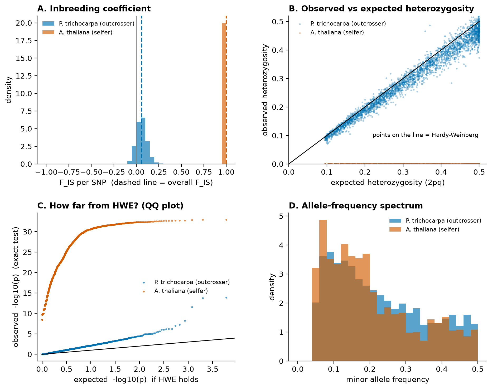

# Mating system and Hardy-Weinberg equilibrium: a selfer vs. an outcrosser

*Vanshika Yadav, Gargi College, University of Delhi, November 2026*

## 1. Question and prediction
How does mating system change genotype frequencies? Selfing should leave almost no heterozygotes (observed heterozygosity far below 2pq, F_IS near 1), whereas random mating gives genotype frequencies p², 2pq, q² and F_IS near 0.

Hardy-Weinberg equilibrium says that in a large, randomly mating population with no selection, mutation or migration, genotype frequencies are p², 2pq and q². F_IS = 1 − H_obs/H_exp measures how far observed heterozygosity departs from that expectation: 0 under random mating, positive when heterozygotes are missing, negative when there are too many.

## 2. Data and filters
* Selfer: *Arabidopsis thaliana*, 1001 Genomes Consortium (2016), Cell 166:481-491, obtained with the VCF subset tool (https://tools.1001genomes.org/vcfsubset). File: `athaliana_subset.vcf`.
* Outcrosser: *Populus trichocarpa*, 4,654 SNP array, Zenodo 10.5281/zenodo.7129889. File: `Panel4SNPv3.vcf`.
* Individuals analysed: 110 (selfer) and 448 (outcrosser). The 110 A. thaliana accessions are those returned by the 1001 Genomes VCF subset tool for the filter "Spain" (Filter records: Spain). Spain is a single country, but its accessions may still belong to more than one ancestry group, and I did not stratify further.
* Only chromosome 1 was analysed for the selfer. I requested Chr1:1..3,000,000, but the download was cut off by a server error at position 2,171,601. I therefore kept the complete first 2 Mb (Chr1:1..2,000,000) and removed non-variant sites before analysis (the pipeline ignores them anyway), so the selfer result covers 2 Mb of one chromosome.
* Biallelic SNPs with minor allele frequency ≥ 0.05: 12,239 (selfer) and 4,654 (outcrosser) passed the filters out of 114,335 and 4,654 biallelic SNPs read; 3,000 SNPs per species were tested after random subsampling (seed 1).
* Marker types: the selfer data are sequencing-based SNPs; the outcrosser data are SNP-array genotypes (4,654 SNPs in the file used), whose pre-selected polymorphic sites carry ascertainment bias. The two are not directly comparable. The selfer genotypes also contain no heterozygous calls.

## 3. Methods
Per-SNP chi-square test of Hardy-Weinberg proportions (1 d.f.), exact test (Wigginton et al. 2005), F_IS = 1 − H_obs/H_exp, and Benjamini-Hochberg FDR and Bonferroni correction across SNPs. Code and unit tests: https://github.com/vanshi2756-gif/selfer-vs-outcrosser-hwe

## 4. Results

| | *P. trichocarpa* (outcrosser) | *A. thaliana* (selfer) |
|---|---|---|
| Individuals analysed | 448 | 110 |
| SNPs tested | 3000 | 3000 |
| Mean observed heterozygosity | 0.299 | 0.000 |
| Mean expected heterozygosity (2pq) | 0.318 | 0.295 |
| Overall F_IS | 0.060 | 1.000 |
| SNPs failing HWE, exact test p < 0.05 (raw) | 25.0% | 100.0% |
| SNPs failing HWE after FDR 5% | 7.7% | 100.0% |
| SNPs failing HWE after Bonferroni | 0.8% | 100.0% |
| SNPs where chi-square is valid (all expected counts ≥ 5) | 79.5% | 35.6% |

Overall F_IS was 1.000 in the selfer and 0.060 in the outcrosser, higher in the selfing species, as predicted. After FDR correction, 100.0% of SNPs deviated from Hardy-Weinberg in the selfer and 7.7% in the outcrosser.

## 5. Discussion
**Do the results match the prediction?** Yes, in direction. The outcrosser is close to Hardy-Weinberg proportions, with a small heterozygote deficit (H_obs 0.299 vs H_exp 0.318, F_IS = 0.060). The selfer shows no heterozygotes (H_obs 0.000 vs H_exp 0.295). The difference between the two species in F_IS is about 0.94.

**The selfer F_IS is at its ceiling.** F_IS = 1.000 is the maximum possible value, so it cannot distinguish degrees of selfing. No heterozygous genotype was present in the *A. thaliana* data. The 1001 Genomes lines are inbred and their genotypes are called as homozygous, so F_IS = 1.000 is partly a property of the call set and not a measured selfing rate. I did not convert it into a selfing rate (s = 2F/(1+F) would give about 1), because that would overstate what the data show. All 3,000 SNPs fail the exact test for the same reason.

**The outcrosser deficit.** 25% of SNPs fail at raw p < 0.05, but only 0.8% after Bonferroni. This fits a mild departure such as population structure or relatedness (Wahlund effect), which lowers observed heterozygosity even under random mating. I did not test this, so it is a possible explanation and not a conclusion. SNP-array ascertainment, genotyping error and linkage could also contribute.

**Reading panel D correctly.** Allele-frequency spectra describe how common each allele is; genotype frequencies describe how those alleles are paired up in individuals. Two species can have similar allele-frequency spectra and still have very different genotype frequencies. Selfing mainly changes how alleles are combined into genotypes: it removes heterozygotes and so lowers observed heterozygosity (panels A and B), not necessarily how common each allele is. A similar panel D is therefore not evidence of similar genotype frequencies. The spectra here also depend on the minor-allele-frequency filter and on array ascertainment in the outcrosser, so differences between them should not be read as biology.

**Handling structure, and what I would do with more time.** I did not stratify by subpopulation. With more time I would choose individuals from a single genetic group or region in each species, thin SNPs to reduce linkage, use the same number of individuals in both species, analyse all five *A. thaliana* chromosomes, and use a call set that retains heterozygous calls so the selfing rate can be estimated.

## 6. Limitations
* **Population structure (Wahlund effect):** pooling different groups lowers observed heterozygosity even under random mating, so a deficit is not automatically due to selfing.
* **Linkage:** neighbouring SNPs are not independent, so the percentages of SNPs failing Hardy-Weinberg overstate how much independent evidence there is.
* **Genotyping error:** miscalled genotypes shift observed heterozygosity and F_IS.
* **Different marker types:** an SNP array (ascertainment bias) is not directly comparable to sequencing-based SNPs.
* **Homozygous-only calls in the selfer:** F_IS = 1.000 reflects this as well as selfing.
* **Partial and unequal sampling:** The selfer data cover 2 Mb of chromosome 1 from 110 individuals, against genome-wide data from 448 individuals in the outcrosser.

## 7. References
McKown et al. (2022) Zenodo 10.5281/zenodo.7129889 (check the record for the associated paper); 1001 Genomes Consortium (2016) Cell 166:481-491; Wigginton et al. (2005) Am J Hum Genet 76:887-893.
