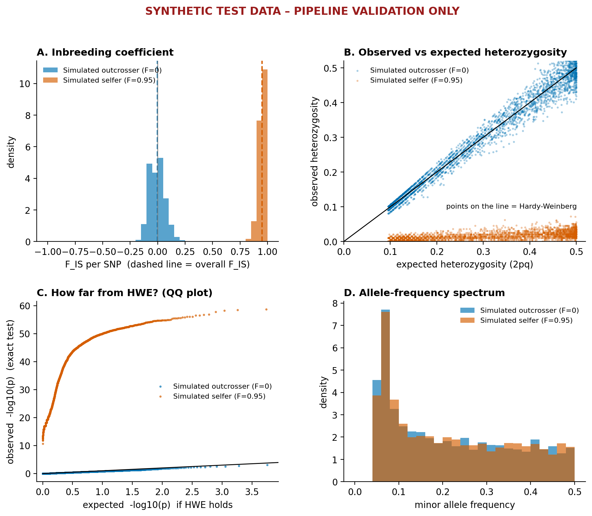

# Mating system and Hardy-Weinberg equilibrium: a selfer vs. an outcrosser

*[Your name, college, date]*

> **SYNTHETIC TEST DATA – PIPELINE VALIDATION ONLY.** These numbers come from simulated genotypes used to verify that the pipeline recovers known parameters. They are not a biological result.

## 1. Question and prediction
How does mating system change genotype frequencies? Selfing should leave almost no heterozygotes
(observed heterozygosity far below 2pq, F_IS near 1), whereas random mating gives genotype
frequencies p^2, 2pq, q^2 and F_IS near 0. [Add 2-3 lines in your own words on Hardy-Weinberg and F_IS.]

## 2. Data and filters
* Selfer: Simulated selfer (F=0.95), from [source, accession or DOI]. File: `sim_selfer.vcf`.
* Outcrosser: Simulated outcrosser (F=0), from [source, accession or DOI]. File: `sim_outcrosser.vcf`.
* Individuals analysed: 200 (selfer) and 200 (outcrosser).
  [State which individuals were chosen and why, for example one region or one genetic group.]
* Biallelic SNPs with minor allele frequency >= 0.05 ; 2730 (selfer) and
  2857 (outcrosser) passed the filters out of 3000 and 3000 read;
  2730 and 2857 were tested after any subsampling.
* [State the marker types, e.g. SNP array vs. whole-genome sequencing, and what that implies.]

## 3. Methods
Per-SNP chi-square test of Hardy-Weinberg proportions (1 d.f.), exact test (Wigginton et al. 2005),
F_IS = 1 - H_obs/H_exp, and Benjamini-Hochberg FDR and Bonferroni correction across SNPs.
Code and unit tests: [repository link].

## 4. Results

| | Simulated outcrosser (F=0) | Simulated selfer (F=0.95) |
|---|---|---|
| Individuals analysed | 200 | 200 |
| SNPs tested | 2857 | 2730 |
| Mean observed heterozygosity | 0.302 | 0.015 |
| Mean expected heterozygosity (2pq) | 0.301 | 0.305 |
| Overall F_IS | -0.003 | 0.950 |
| SNPs failing HWE, exact test p < 0.05 (raw) | 2.3% | 100.0% |
| SNPs failing HWE after FDR 5% | 0.0% | 100.0% |
| SNPs failing HWE after Bonferroni | 0.0% | 100.0% |
| SNPs where chi-square is valid (all expected counts >= 5) | 55.3% | 56.5% |

Overall F_IS was 0.950 in the selfer and -0.003 in the outcrosser, higher in the selfing species, as predicted.
After FDR correction, 100.0% of SNPs deviated from Hardy-Weinberg in the selfer and
0.0% in the outcrosser.

## 5. Discussion
* **Pipeline validation against known parameters:** In the simulated outcrosser ($F = 0$), observed heterozygosity ($0.302$) matched expected heterozygosity ($0.301$), yielding overall $F_{\text{IS}} = -0.003$ and $0.0\%$ of SNPs failing HWE after FDR correction. In the simulated selfer ($F = 0.95$), observed heterozygosity dropped to $0.015$ against $H_{\text{exp}} = 0.305$, recovering overall $F_{\text{IS}} = 0.950$ with $100.0\%$ of SNPs deviating significantly from HWE.
* **Allele-frequency spectrum vs. genotype frequencies (Panel D vs. Panels A–B):** Although the minor allele frequency (MAF) spectra of the simulated selfer and outcrosser are nearly identical (Panel D), their genotype distributions diverge sharply (Panels A–B). Selfing does not directly alter allele frequencies ($p, q$) in the absence of selection or drift; instead, it redistributes existing alleles out of heterozygotes ($Aa$) and into homozygotes ($AA, aa$), reducing $H_{\text{obs}}$ relative to $2pq$.
* **Biological interpretation boundary:** This synthetic run demonstrates only that the statistical and plotting pipeline accurately recovers ground-truth $F_{\text{IS}}$ and HWE deviations. It does not establish biological parameter values for *Arabidopsis thaliana* or *Populus trichocarpa*, which require running the pipeline on the empirical datasets.

## 6. Limitations
* **Synthetic validation only:** Results in `example_synthetic/` are generated from simulated genotypes; empirical analyses of *A. thaliana* and *P. trichocarpa* must account for real-world confounding factors.
* **Population structure (Wahlund effect):** Pooling genetically differentiated subpopulations creates a heterozygote deficit ($F_{\text{IS}} > 0$) even under random mating (as demonstrated in `structured_hwe.summary.json`, where 4 subpopulations with $F_{\text{ST}} = 0.05$ produce $F_{\text{IS}} = 0.036$).
* **Linkage disequilibrium:** Neighbouring SNPs on a chromosome are not statistically independent, which can inflate counts of significant HWE deviations if unthinned.
* **Genotyping error and marker ascertainment:** Low-frequency genotype calling errors in inbred lines (such as *A. thaliana* accessions) can create apparent residual heterozygosity, while SNP-array ascertainment bias in *P. trichocarpa* enriches for intermediate-frequency variants.

## 7. References
McKown et al. (2022) Zenodo 10.5281/zenodo.7129889 (check the record for the associated paper);
1001 Genomes Consortium (2016) Cell 166:481-491; Wigginton et al. (2005) Am J Hum Genet 76:887-893.
